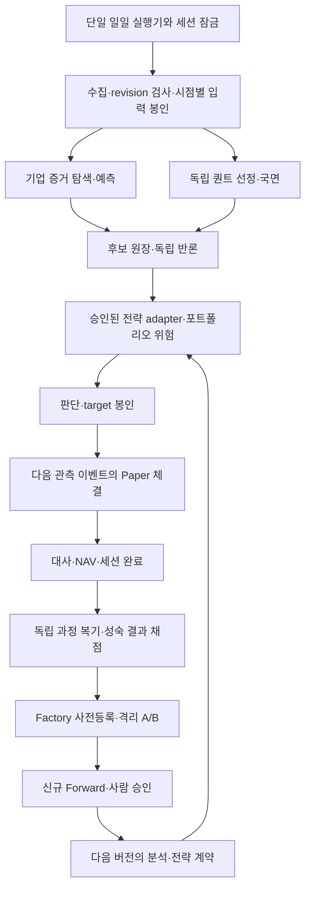

# Task 2 · 자율 투자 멀티에이전트 최종 아키텍처

2026-11-13 KST · 설계 확정, 구현 전 · 기준: [Task 1 감사](01_system_baseline.md), AGENTS.md, 현재 실행 코드. 삭제된 연구 문서는 복원하지 않고 이전 대화와 Git HEAD의 `docs/research/03_investment_skills.md`를 재사용했다. 아래 신규 계약·상태·파일명은 구현할 사양이며 현재 동작 증거가 아니다.

## 1. 최종 추천과 선정 이유

**기존 결정론적 Paper 엔진과 Factory를 보완하고, 단일 일일 실행기 아래 독립 기업가치·퀀트 후보, 봉인된 판단, 독립 복기를 연결한다.** PostgreSQL이 작업 진행과 거래 상태를 관리하고 원문 파일은 해시로 참조한다. 별도 메시지 브로커·벡터 DB·전체 외부 매매 프레임워크는 초기 구성에서 제외한다.

- **발굴은 두 경로다.** 기업 분석은 공식 공시와 제한된 뉴스에서 후보와 예측을 만들고, 퀀트는 승인된 유니버스의 가격·유동성·국면에서 독립 후보를 만든다. 한쪽의 미선정이 다른 쪽을 거부하지 않는다. 각 경로의 필수 자료가 없으면 해당 경로는 기권한다.
- **매매는 계약으로 실행한다.** LLM은 근거·예측·개선안을 작성한다. 승인된 전략 버전의 진입·청산·수량·위험 정책만 결정론적 실행기에 전달한다. 기존 V69는 그대로 비교 기준이며 신규 기업 전략은 별도 Shadow/Paper 후보로 시작한다.
- **매일 복기하고, 검증 후 변경한다.** 판단 과정과 실현 결과를 따로 평가하고 Factory에 개선안을 등록한다. 데이터·프롬프트·지표·매매·복기 변경은 하나씩 A/B한다. 신규 Forward와 계약 기간, 사람 승인 없이 부모·Champion·Live를 바꾸지 않는다.
- **한 실행 권위만 둔다.** Ubuntu systemd timer가 단일 CLI를 호출한다. Hermes는 연구 기억·제한된 위임의 선택적 작업자로 사용하고 거래 예약·승인·원장 권한은 주지 않는다. TradingAgents와 RD-Agent 전체 런타임은 초기 필수 의존성에서 제외한다.
- **복원이 먼저다.** 누락된 runtime·canonical 및 테스트 DB를 Task 3 첫 단계에서 해결한다. 복원 불가한 역사 자료는 미확인으로 남기고 신규 관측을 시작한다. 과거 평가나 동결 자료를 재수집 자료로 덮어쓰지 않는다.

이 선택은 기존 시점·해시·멱등성·대사 검사를 재사용해 구현과 회귀 비용을 줄인다. 새로 필요한 것은 거래 엔진 전체보다 증거·후보·예측·복기의 연결이다. 이 구조가 투자 성과를 개선한다는 증거는 아직 없다. 엔진 자체의 결함이 동일 계약의 복구·회계 테스트에서 해소되지 않으면 해당 모듈의 교체를 별도 결정한다.

## 2. 유지·보완·교체 결정

| 모듈 | 선택 | 비용·검증·효용·안정성의 판단 |
|---|---|---|
| V69 부모 및 기존 V79 연구 adapter | 그대로 재사용 | 동결 비교 기준. 기존 성과를 재계산 없이 수정하지 않음. V79 비활성 후보는 자동 활성화하지 않음 |
| 가격 수집·V87 revision·PIT·V94/V95/V102 | 기존 코드 보완 | 관측/수정 시각과 입력 manifest를 연결. 새 자료 계약 검증은 필요하나 기존 계산 재작성은 불필요 |
| 기업 발굴·시나리오·예측 등록 | 신규 모듈 구축 | 현재 통합 기능이 없음. 공통 구조화 출력과 좁은 소스 범위로 시작; 효용은 별도 실측 |
| Paper decision/execution/store | 기존 코드 보완 | receipt·V101·client_order_id·내부 대사 재사용. Forward 체결 adapter와 재시작 상태를 추가하고 회계 동일성 검증 |
| 복기/V103 | 기존 코드 보완 | 기존 연구 집계는 유지하고 거래·예측별 독립 평가를 추가. V103을 거래 복기로 오인하지 않음 |
| Factory | 기존 코드 보완 | 기존 계약·중복·예산·승격 제한 유지. 현재 YAML 고정 제안·DRY_RUN_ONLY를 일반 제안 등록 API와 격리 평가 작업으로 확장 |
| 투자 스킬 4종 | 외부 기술로 부분 교체 | 아래 고정된 기능/양식만 비교 적용. 전체 번들·보고서 제작·중복 DCF는 제외 |
| TradingAgents | 불필요하므로 전체 런타임 제외 | 독립 반론·복기 양식만 비교 참고. 기존 scripted graph/체크포인트 검증은 투자 판단 효능 증거가 아님 |
| RD-Agent | 초기 런타임 제외, Task 4 격리 제안자만 선택 | Factory를 대체하지 않음. 실제 생성 코드 실행·Qlib 평가 미검증; 고정 제안 인터페이스에서 이득이 있을 때만 부분 통합 |
| Hermes | 외부 기술로 부분 교체 | Task 4 연구 검색·위임 adapter만 허용. 별도 설치 재사용, 작업 상태 권위는 프로젝트 DB. 효과 없으면 기본 Python 작업자로 대체 |
| V85 반복 scheduler | 신규 일일 경로로 부분 교체 | Task 5 병행 검증 후 운영 예약에서 제외. 연구 재현 코드는 보존. 두 scheduler의 같은 계좌 동시 실행 금지 |
| Live·별도 실행 엔진 | 현재 범위에서 제외 | 하드락 유지. 실제 브로커 주문·체결·복구 계약은 별도 작업과 승인 필요 |

### 투자 스킬 4종의 적용 계약

스킬은 모델 역할과 체크리스트를 고정하는 연구 구성요소다. 모델에는 필요한 부분만 제공하고, 원본 commit·로컬 번역/수정 해시·프롬프트 해시·도구 목록을 기록한다. 원문에 포함된 실행 지시를 신뢰하지 않으며 스킬이 전략·DB·권한을 직접 수정하지 못한다. 아래 적용은 아직 구현·효능 검증 전이다.

| 스킬·기존 고정 버전 | 담당 역할과 연결 위치 | 실제 적용 방식 | A/B 검증 |
|---|---|---|---|
| **investor-harness** `491cb380` | `news_shadow_runtime`/RSS 수집 다음, 새 기업 후보 생성 앞. 촉매 탐색·컨센서스 확인·독립 반론 | `sm-catalyst-sweep`를 관측 목록→업종→허용 유니버스로 확장하는 제한 검색 작업에 적용. iFind·중국 전용 예시는 KRX 공시·IR로 변환. 사실/추론, 반증·다음 관측을 출력. `sm-consensus-watch`는 시점별 컨센서스가 없으면 기대 차이를 기권. `sm-red-team`은 첫 판단 봉인 후 별도 작업에서 비교 | 무스킬 동일 모델에 같은 검색 풀·도구·총 예산 부여. 최초 질문에 없던 검증된 중요 사실/호출, 발견 지연, 중복·오탐·비용 측정. 반론 추가는 별도 제거 실험 |
| **anthropics/financial-services** `60565064` | 기업 후보→봉인 예측 등록 사이, `earnings-preview` | 당시 가이던스·부문 수치·컨센서스에서 1/2/4분기 매출·EPS·FCF의 bear/base/bull과 확률·단위·가정을 JSON으로 저장. 결측 항목은 기권하고 나머지 가능한 지표만 출력. 워크북·덱 생성 제외 | 발굴 결과를 공통 원문 묶음으로 고정하고 무스킬 대비 MAE/규모 정규화 오차·Brier·구간 폭/커버리지·기권율·비용 비교. 당시 컨센서스 대비 오차는 자료 있는 사례만 |
| **rollingSirius/equity-research-skill** `3d94e64f` | 예측→기업 후보 평가의 기대 역산 단계; 기존 V102 재무 위험과 별개 | 고정 `dcf.py`를 격리 계산 작업으로 호출. 시점별 가격·주식 수·순부채·현금흐름과 사전등록 할인율/마진 범위를 입력하고 요구 성장률·희석·민감도를 기록. LLM 계산값 대신 계산기 결과를 검산. 데이터 없으면 해당 분석 기권 | 양쪽에 동일 계산기·입력·예산을 주고 스킬 해석 체크 유무 비교. 수치/단위 오류, 가정 회수, 기대 역산 재현성·허위 확신·비용 채점. 역산값은 시장 컨센서스로 부르지 않음. 예측·투자 성과는 별도 평가 |
| **InvestSkill** `cba40eeb` | Paper/예측 원장→새 독립 복기→V103/Factory 연결 | `trade-postmortem`의 과정·계획 준수·편향·수익 원천 양식을 구조화. 기존 thesis-tracker 파일을 새로 권위로 만들지 않고 봉인된 decision/thesis 기록을 읽는 adapter 사용. 사전 과정 평가와 사후 수치 채점을 분리 | 같은 거래·예측에 기본 복기 대조군과 동일 모델/예산 비교. 독립 검토자와 원인 분류 일치, 근거 없는 사후 서사, 재현 가능한 개선 가설·비용 측정. 성숙 복기/빈 기록/동일 길이 무관 기록의 다음 판단 비교는 별도 실험 |

이전 연구에서 equity 스크립트/보고서 검사와 합성 DCF 계산은 실행됐으나 발견·예측 우위는 입증되지 않았다. Ubuntu 최소 A/B는 재구성된 한 Apple 사례에서 점 예측이 같았고 하드 토큰 통제가 없었다. 네 스킬 모두 연구 후보이며 기본 전략 활성화 근거가 아니다. prompts.chat과 ai-hedge-fund 전체 스타일 묶음은 초기 분석 스택에서 제외한다.

## 3. 전체 흐름과 실행 계약

### 수집·시점·발굴

초기 범위는 한국 시장의 승인된 ETF/개별주 유니버스, Toss 일봉·KS11, OpenDART와 기업 IR, 제한된 RSS다. 기업 관측 목록은 ETF 선정 결과와 독립적으로 구성하고 주기적 유니버스 순회를 배정한다. 검색이 기존 목록 밖 회사를 발견하면 근거는 보존하되 당시 거래 가능·코드 매핑 검증 전 주문 적격 후보로 만들지 않는다.

`source_class`는 `OFFICIAL_FACT`, `MEDIA_REPORT`, `SENTIMENT`로 구분한다. 공식 발표도 회사 주장과 검증 사실을 구분한다. 후속 거시·변동성은 공식 지표/기존 가격으로 계산 가능한 자료부터, 커뮤니티 심리는 권리·조작·비용 검증 후 연구 전용으로 추가한다. 필수 자료가 아닌 소스의 장애가 정상인 다른 전략을 전부 막지 않게 전략별 필수 소스 목록을 둔다.

모든 관측은 `observation_id, entity_id, instrument_id, source_class, document_id, source_url, source_hash, published_at, first_seen_at, ingested_at, effective_at, revision_of, timestamp_precision, collection_cost`를 갖는다. 원문 수치·통화·단위와 라이선스도 보존한다. 정밀 시각 미상은 null로 두고 날짜를 장 시작 시각으로 바꾸지 않는다. 기존 OpenDART 날짜 전용 결과는 진단으로 유지한다. 수신 당시의 검증된 기록이 있으면 그 이후 Forward 용도로만 별도 적격 판정을 받으며, 과거 시점에 소급 적용하지 않는다. 정정은 원본 보존 후 revision gate로 처리한다.

기업·퀀트 공통 후보는 `candidate_id, origin, strategy_id, universe_version, evidence_ids, as_of, horizon, thesis, forecast_ids, invalidation, confidence, eligibility, input_hash`를 기록한다. 동일 input manifest를 읽되 첫 출력까지 서로의 후보·논거를 보지 않는다. confidence는 자본 배분 허가가 아니다. 개별 기업 자료를 정적 ETF 매핑으로 자동 전파하지 않는다.

### 전략·시간·위험

| 경로 | 기간·데이터 | 진입·청산·배분 계약 |
|---|---|---|
| 기존 V69 기준선 | 기존 일봉·국면·유니버스 | 현재 파라미터/시점/비용/위험 그대로. 기업 후보·LLM 판단을 추가 필터로 섞지 않음 |
| 신규 기업 전략 v1 | 분기 예측을 기록하되 거래는 일봉 기반, 보유 기간은 후보 사전등록 때 고정 | Task 3에서 검증 가능한 정형 후보 점수→진입/청산·유효기간 규칙을 별도 사전등록. 자료·규칙이 없으면 Shadow만 실행. 규칙 개발은 버그 수정과 분리 |
| 신규 퀀트 후보 | 일봉 기본, V79 adapter 재사용 가능 | 후보별 고정 규칙·국면/변동성 대응·재평가 주기 등록 후 격리 Paper. 현재 비활성 후보를 묵시 활성화하지 않음 |
| 5분 확인 연구 | 완료된 5분봉·다음 1분봉 등 원 계약 | 기존 `daily_target_5m_price_confirm_v1` 재사용 연구만. 분봉 복원과 동일 체결 검증 후 별도 후보. 일봉으로 결측 보간 금지 |

WebSocket·장중 손절은 초기 요구사항이 아니다. 계약에 장중 대응이 있는 전략만 완료 봉/시세 이벤트를 요구한다. 위험 계약에는 종목/업종/총노출·현금·유동성·회전·손실 제한·레버리지 허용 여부·시장 국면 및 변동성별 행동을 필수 필드로 둔다. 수치는 기존 전략은 기존 값을, 신규 전략은 평가 전 사전등록한 값을 사용하며 설계 문서에서 성과를 보고 임의 지정하지 않는다. 누락 정책은 주문 부적격이다. LLM은 손절/익절·한도·파라미터를 변경할 권한이 없다.

후보는 전략별 sleeve에 배정하고 각 독립 Paper 평가에는 동일 초기 자본·공통 비용 계약을 적용한다. 초기에는 **현재 저장소가 singleton 계좌를 강제하므로 전략별 별도 Paper DB**를 사용한다. 기존 PRIMARY 계좌와 DB를 변경하지 않는다. 신규 orchestration의 전역 위험 계산은 모든 sleeve의 봉인된 target을 합산하고 동일 종목/업종 중복, 상충 매수·매도를 검사한다. 후보 비교용 독립 계좌 NAV를 합쳐 실제 포트폴리오 성과로 표현하지 않는다. 실제 통합 배분안은 별도 portfolio Paper DB와 고정된 배분/충돌 규칙으로 검증한다. 위험 적격성을 제외한 기업/퀀트 간 선택은 한쪽의 veto로 구현하지 않는다.

### 실제 일일 실행·복구

새 얇은 `scripts/run_investment_cycle.py`가 기존 함수를 호출하도록 Task 3에서 추가한다. 단계는 `OBSERVED → SEALED → DECIDED → EXECUTING → RECONCILED → COMPLETE`, 실패/불확실은 `HOLD_ONLY`, 결과 평가는 별도 작업이다. DB 작업 키는 시장·세션·계좌·전략/입력/설정 해시로 고정한다. lease와 유일 키로 중복 실행을 막고 이미 봉인된 입력은 재시도 때 재검색하지 않는다.

**현재 일일 preview가 역사 D일 시가를 읽는 부분은 Forward 동작과 분리해야 한다.** Task 3는 D-1 확정 자료로 D 개장 전 결정을 봉인하고, 이후 실제 수신한 D일 가격 이벤트로만 Paper 체결한다. 사후 수집한 시가·수정 가격으로 과거 실행했다고 기록하지 않는다. 기존 역사 replay와 전략 계산은 보존하고 Forward 가격/체결 adapter를 추가해 계약을 시험한다. 장 마감 자료로 내린 판단은 다음 적격 거래 이벤트부터 체결한다. 실제 다음 시가 관측을 놓치면 계약상 미체결 처리하며 종가 대체 체결을 하지 않는다.

재시작은 데이터/DB 스키마·hardlock 확인 → 미완료 세션/기존 client_order_id 조회 → 체결·현금·포지션 재구성 → 가격 기준 확인 → NAV 재산출·대사 순서다. 주문 커밋 직후/NAV 저장 전 종료도 동일 주문을 재발행하지 않는다. 재대사 실패 시 신규 주문 차단. Paper 내부 계좌는 실제 브로커 계좌 잔고와 동일해야 하는 대상이 아니므로 둘을 합산하거나 강제로 맞추지 않는다. 외부 관측의 미확정 주문·계약 불일치는 별도 게이트로 차단하며 Live 주문 복구 검증으로 간주하지 않는다.

## 4. 에이전트·저장소별 책임

| 담당 | 읽기·쓰기와 권한 |
|---|---|
| Collector / Universe / Regime | 허용 소스 읽기, 원문·관측 manifest·PIT 특징 작성. 주문 권한 없음 |
| 기업 Analyst / Quant Analyst | 고정 입력에서 독립 후보·봉인 예측 작성. 전략 설정·계좌 쓰기 없음 |
| Independent Challenger | 첫 판단 봉인 후 반증·누락 점검. 원 판단 수정 불가, 별도 결과 기록 |
| Portfolio/Risk/Execution | 승인된 규칙과 receipt 검사, target·Paper intent·fill·대사/NAV 작성. LLM 호출이 없어도 안전 차단 가능 |
| Reviewer / Outcome scorer | 과정 평가는 당시 근거만, 성숙 결과 평가는 별도 접근. 예측 수치는 결정론적 코드로 채점. 거래 수정·승격 권한 없음 |
| Factory registrar / evaluator | 검토된 제안 append, 중복·예산 검사, 격리 평가. 연구 worker는 최종 holdout·승인 비밀·브로커 credential 접근 불가 |
| Hermes worker | 연구 ID 검색·미완료 작업 재개·제한된 위임 제안. 원문/계좌/Factory 공식 기록은 adapter 경유, 직접 쓰기 금지. cron·거래 예약 비활성 |

저장은 세 가지 권위로 단순화한다.

1. **증거 파일과 manifest:** 영속 볼륨의 원문·해시·revision·snapshot. 기존 canonical은 동결본과 신규 Forward 분리. 누락·해시 불일치면 복원 또는 차단.
2. **PostgreSQL:** 프로젝트 control DB에 observation index, candidate/thesis, forecast, analysis_run, review, job_run, evaluation, approval 추가. Paper DB는 기존 테이블 유지. 서로 다른 DB 간 진행은 영수증 기반 재시도로 연결하며 분산 트랜잭션을 도입하지 않는다. `analysis_run`은 모델/공급자/설정·프롬프트/스킬·도구/입력 해시, 요청/응답 참조, 토큰/검색/비용/시간·실패를 보존한다. 예측은 값·단위·기간·확률·구간·라벨 성숙 시점, 변경은 supersedes로 기록한다.
3. **Factory append-only 원장:** 기존 계약과 시도 JSONL이 승인·실험 이력의 권위다. control DB는 원장 해시를 참조하는 작업 인덱스이며 이중 승인 기록을 만들지 않는다. Hermes 기억·FTS는 연구 ID와 요약의 폐기 가능한 캐시다.

호스트는 systemd service/timer 하나만 주기 호출하고 거래소 세션·단계 적격성은 CLI가 판정한다. 장 전/개장 이후/장 마감 같은 여러 tick은 같은 상태기계를 재개한다. 테스트 DB는 삭제 가능한 프로젝트 전용 PostgreSQL 인스턴스/볼륨, Forward Paper DB는 별도 영속 볼륨과 역할을 둔다. 현 `TEST_DATABASE_URL` 격리 검사는 초기 유지하며 수용 시험과 Forward에 서로 다른 URL을 명시 주입한다. 이름이 TEST라는 이유로 Forward DB를 테스트 정리 작업에 전달하지 않도록 실행 프로필·DB identity를 검증한다.

`runtime/`도 명시적 영속 볼륨에 포함한다. 매일 DB dump와 원문/Factory/설정 해시 manifest를 함께 백업하고 버전별 복원 시험을 한다. 목표 RPO는 한 일일 세션 이내, RTO는 다음 거래 세션 전으로 설정하되 Task 5에서 실측한다. 복원 후 미완료 주문·세션을 재대사하기 전 실행을 재개하지 않는다.

## 5. Task 3~5 실행 순서와 완료 기준

### Task 3 — 통합 투자·매매 파이프라인

**3.0 데이터·개발 게이트.** 기존 백업에서 runtime/분봉/V87 canonical의 원본 manifest·해시·기간을 확인해 별도 경로로 복원한다. 백업이 없으면 누락 원장을 남기고 신규 수집을 시작한다. 현재 API로 재다운로드한 역사는 `retrieved_at`을 붙인 새 revision이며 과거 최초 관측 증거로 사용하지 않는다. V87·revision gate 통과 전 canonical 편입 금지. 기존 V84·릴리스 결과는 그대로 둔다. 프로젝트 전용 PostgreSQL test와 Paper 프로필, schema migration/identity 검사 및 현재 누락된 psycopg·dotenv의 최소 의존성 고정을 구현한다.

**3.1 연결.** Collector와 제한된 기업·퀀트 독립 후보, 공통 candidate/forecast 스키마와 analysis_run, 새 일일 CLI·단계 상태 저장을 구현한다. 재사용: `active_market_data_update`, `news_shadow_runtime`, `rss_news_shadow`, V94/V95/V100/V102 adapter. 기업 스킬은 우선 촉매 기능 하나를 비교하고 나머지는 데이터 적격 사례에 순차 적용한다.

**3.2 실행.** 기존 V69/기존 receipt·V101·Paper store를 기준선으로 연결하고 신규 정형 기업 전략은 별도 사전등록·계좌에서 검증한다. Forward 가격 이벤트 adapter, 전역 위험 preview와 재대사를 추가한다. 기업 전략이 아직 등록되지 않았으면 Task 3 중간 결과는 Shadow이며 전체 완료로 부르지 않는다.

필수 시험: AGENTS 최소·운영 추가 묶음, `test_news_shadow_runtime`, `test_rss_news_shadow`, `test_paper_decision_preview`, `test_daily_paper_cycle`, `test_paper_execution_runtime`, `test_paper_execution_safety_gates`. 새 의미 있는 시험은 cutoff 이후 자료 주입 불변성, 두 경로 독립 발굴·기권, 후보/target lineage, 다음 이벤트 전 체결 불가, 동일 요청 재실행과 계좌/전역 위험을 다룬다.

**완료:** 실제 제한 소스 수집 1회 이상의 원문 영수증, 두 독립 경로의 후보 또는 근거 있는 기권 기록, 승인된 정형 규칙으로 기업·퀀트 각각 격리 Paper 판단→체결/미체결→NAV까지 실행 증거가 있다. DB 17개 수용 시험은 skipped 없이 통과해야 한다. 합성 입력 통과만으로 완료하지 않는다. 실제 데이터가 주문을 만들지 않는 날은 미주문이 정상이며, 주문 동작 자체는 격리 fixture로 별도 검증한다. Task 4는 봉인된 판단·예측·거래 ID를 의존한다.

### Task 4 — 독립 복기·자기개선·연구 운영

독립 과정/결과 채점과 아래 원인 태그를 구현한다: `INFORMATION_MISSING`, `FORECAST_ERROR`, `SELECTION`, `TIMING`, `SIZING`, `EXECUTION`, `STOCHASTIC_LOSS`, `UNDETERMINED`. 복수 태그·근거·불확실성을 허용하고 단순 손실을 실패로 분류하지 않는다. 매일 과정/계획 준수를 검사하고 장기 라벨은 성숙 전 `PENDING`이다. 수정·후속 예측도 원본을 보존한다.

V103 집계와 Factory 사전계약·중복/전이·비용/예산·replay adapter를 재사용한다. 신규 제안은 원인·변경 대상·A/B 차이·입력·분할·주평가지표·최소 유효 차이·표본/기간·중단 기준·비용 한도·candidate fingerprint를 평가 전에 봉인한다. 생성 코드 실행은 읽기 전용 입력·네트워크 기본 차단·자원 제한 컨테이너에서 한다. 프롬프트/정보원 개선도 같은 등록 경로를 쓴다.

공통 A/B: A0 기존 입력, A1 동일 모델 무스킬+공통 자료, B1 기능 하나 변경, B2 독립 반론, B3 성숙 복기. 순차 효과를 분리하고 실행 순서 무작위화·결과 가림·독립 채점을 적용한다. 동일 snapshot·검색 풀·모델·총 입력/출력/추론 토큰·도구·재시도 예산을 통제한다. 공급자가 하드 토큰 제한이나 모델 고정을 지원하지 않으면 그 실험은 예산 통제 미완료로 표시하며 엄격 A/B 통과로 치지 않는다. 구독 건별 비용 미상은 0원이 아니다.

평가는 발견 정확도/지연, 예측 MAE·Brier·구간, 투자 비용 후 성과/낙폭, 복기 원인 일치율과 비용을 각각 보고한다. 결과를 합산해 임의 승자를 만들지 않는다. 시계열 분할·중첩 라벨 purge/embargo·다중비교·실패 후보 원장을 유지하고 고정 holdout은 제안자에게 숨긴다. 공개 역사 시험은 기능 진단, 동결 후 신규 Forward는 별도 최종 효능 증거다.

Hermes는 제한 연구 검색·작업 재개 한 기능부터 기본 DB 작업자와 비교한다. RD-Agent 제안자는 같은 인터페이스와 예산에서 선택 실험만 한다. TradingAgents 전체 그래프를 별도 스케줄러로 띄우지 않는다.

필수 시험: 기존 Factory/diagnostics/completion/robustness·V103/V89와 새 성숙 라벨·holdout 접근 차단·중복 제안·원장-DB 재시도·잘못된 기억/미래 수정본 회수·위임 강제 종료 시험. **완료:** 실제 기록을 복기하고 개선 가설 1건 이상이 독립 평가에서 채택/기각/기권의 영수증을 남긴다. 합성·역사·Forward 판정을 분리하고 자동 활성화는 0건이다. 효능 미입증 후보의 기각도 정상 완료다. Task 5는 이 연결과 동결된 실험 계약을 의존한다.

### Task 5 — 통합 검증·지속 운영

하나의 systemd timer로 실제 일일 상태기계를 운영하고 V85 중복 예약을 제거한 배포 설정을 검증한다. 장 휴일·지연 데이터·API timeout·LLM 실패/예산 초과·DB 중단, 주문 커밋 직후/NAV 직전 강제 종료, 중복 tick과 백업 복원을 시험한다. 신규 Forward 비교는 기준선/후보 동일 세션 입력 해시와 고정 fingerprint를 보장하고 변경된 의사결정·체결·비용까지 기록한다.

기존 AGENTS 전체 요구·PostgreSQL 수용·새 통합/장애 시험을 수행한다. V104 runner는 해당 원 계약을 그대로 실행하며 데이터 종료가 동결일 이하라면 `NO_NEW_SESSION_AFTER_V104_FREEZE`, append 0을 기대한다. 새 프로젝트 관측을 기존 V104 카운터에 섞지 않는다.

**완료:** 사전등록한 관측 기간/유효 세션 수를 충족한 운영 원장, 모든 계좌 대사와 백업 복원 영수증, 비용·실패·기권·누락/스킵 없는 검증 목록이 있다. 구체 기간과 표본 수는 Task 4 실험 등록 시 고정하고 관측 후 줄이지 않는다. 실현 결과 미성숙·자료 부족은 pending으로 유지한다. 운영 연결 통과와 투자/자기개선 효능 판정은 별도다. 분석·정보원·전략 변경은 독립 검증과 계약된 Forward 기간·사람 승인 후 다음 버전에 반영한다. Live는 이 Task의 완료 대상이 아니다.

## 6. 위험·미검증 가정과 코드 근거

- Task 1 시점 runtime·분봉·V87 자료 부재, DB/credential 미설정, 전략 비활성 및 신규 Forward 0이라는 공백은 아직 해결됐다는 증거가 없다. Task 1의 24개 통과·17 skipped는 이번 설계의 통합 검증 결과가 아니다.
- 현재 단일 계좌·V69 고정과 역사 시가 경로 때문에 단순 CLI 연결만으로 다중전략 Forward가 완성되지 않는다. 격리 DB로 시작하는 비용은 수용하되 규모가 커질 때만 다중 계좌 migration을 재평가한다.
- 정확한 공시 시각·컨센서스·PIT 구성종목·데이터 권리가 부족할 수 있다. 자료 없는 예측·기대 차이·과거 검증은 기권하며 LLM 기억으로 메우지 않는다.
- 동일 모델의 독립 세션은 오류 독립성을 보장하지 않는다. 독립 채점과 신규 Forward로 확인한다. 스킬·Hermes·RD-Agent 통합은 운영비와 효용을 실측해야 한다.
- 가격·분할·기업행사·비용/유동성 계약과 실제 broker-state 복구는 별도 검증 대상이다. Paper 통과가 실제 체결 가능성을 증명하지 않는다.

현재 연결 근거: `scripts/run_daily_paper_cycle.py`, `src/quant_harness/daily_paper_runtime.py`, `paper_decision_runtime.py:_strategy_base_cached`(V69 고정), `paper_runtime_store.py:DDL`(singleton), `paper_execution_runtime.py`(멱등성·대사), `v104_end_to_end_causal_challenger_audit/adapter.py`, `news_shadow_runtime.py`(날짜 전용 공시 진단), `alpha_research_factory*.py`, `v103_review_feedback_agent/engine.py`, `config/v104_challenger_runtime_contract.yaml`, `config/daily_target_5m_price_confirm_v1.yaml`, `compose.yaml`. 이 문서 작업은 코드·운영 전략·주문 경로·설정·Live 권한을 변경하지 않는다.
